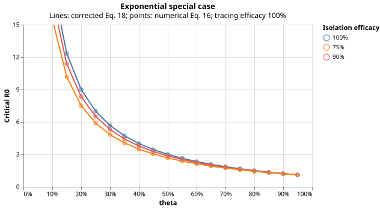

# Deterministic mathematics

## Definitions and the black lines

Let $\tau$ denote time since infection, $g$ a normalized infectiousness density, and $S$ the incubation **survival function**: the probability symptoms have not appeared.
Isolation and tracing efficacies are $\varepsilon_I$ and $\varepsilon_T$.
Equations 3, 4, and 7 give

\[ \beta(\tau)=R_0g(\tau),\quad \int_0^\infty g(\tau)\,d\tau=1,\quad T_g=\int_0^\infty\tau g(\tau)\,d\tau,\quad \theta=\int_0^\infty g(\tau)S(\tau)\,d\tau.
\]

Here $\theta$ is the fraction of transmission before symptoms, including transmission by never-symptomatic infections if $S(\infty) > 0$.
The gamma examples have $S(\infty) = 0$: everyone eventually develops symptoms.

Isolation leaves presymptomatic transmission intact and a fraction $1 - \varepsilon_I$ of symptomatic transmission.
Equation 6 becomes

\[ R_I=R_0\{\theta+(1-\varepsilon_I)(1-\theta)\} =R_0(1-\varepsilon_I+\varepsilon_I\theta).
\]

Setting $R_I = 1$ gives the black curves:

\[ R\_{0,\mathrm{critical}}=\frac{1}{1-\varepsilon_I+\varepsilon_I\theta}.
\]

Control requires $R_0 < R_{0,\mathrm{critical}}$.
Use $\varepsilon_I = 1,0.9,0.75$ for the three panels.
No PDE or simulation is needed.
At perfect isolation the threshold is $1/\theta$, infinite at $\theta = 0$.
At $\theta = 1$, every threshold equals 1.
In code: `fraser.isolation_threshold(theta, isolation)`.

## Gamma calibration

Both infectiousness and incubation densities are gamma distributions with shape $k = 1/c$, where $c = \mathrm{variance}/\mathrm{mean}^2$.
The paper uses $c = 0.1$ (shape 10) and $c = 0.5$ (shape 2).
Fix $T_g = 3$ arbitrary units and infectiousness scale $a = T_g/k$.
Incubation has scale $b$:

\[ g(t)=\mathrm{GammaPDF}(t;k,a),\qquad S(t)=\mathrm{GammaSF}(t;k,b).
\]

Choose $b$ to obtain each requested $\theta$.
For independent gamma variables $X \sim \mathrm{Gamma}(k,a)$ and $Z \sim \mathrm{Gamma}(k,b)$,

\[ \theta=P(X<Z)=I\_{b/(a+b)}(k,k),\qquad z=I^{-1}\_{\theta}(k,k),\qquad b=a\frac{z}{1-z}.
\]

$I$ is the regularized incomplete beta function.
Scaling both gammas to unit scale makes their ratio to their sum beta-distributed, giving this identity.
`fraser.gamma_parameters` uses SciPy's `betaincinv`, with no root search.
Changing both time scales proportionally does not change the thresholds.
The numerical API uses $0 < \theta < 1$ and integer shapes, including 1, 2, and 10.
It does not support arbitrary gamma shapes.
The plots add the known endpoint $(\theta,R_0) = (1,1)$ separately.

## Equation 16: from notation to code

The paper's $(\cdot)$ means an **input function** $f$.
Write the operator as

\[ (\mathcal K\_{R_0}f)(\tau) =R_0g(\tau)A(\tau)\int_0^\infty B(\tau,\rho)f(\rho)\,d\rho, \]

\[ A(\tau)=1-\varepsilon_I+\varepsilon_I S(\tau),\qquad B(\tau,\rho)=1-\varepsilon_T+ \varepsilon_T\frac{S(\rho+\tau)}{S(\rho)}.
\]

- $\rho$ is the previous transmission interval: the infection age of an individual's infector when that individual was infected.
- $\tau$ is that individual's infection age when generating the next infection.
- $f(\rho)$ describes incidence indexed by the previous interval; the output is indexed by the next interval $\tau$.

The ratio is the probability an infector remains symptom-free another $\tau$ after transmission at infection age $\rho$, conditional on being symptom-free at $\rho$.
Its use here is part of the independent approximation, not a repair of the missing isolation/tracing correlation.

At zero growth, Equation 15 gives $f = \mathcal K_{R_0}f$: the dominant eigenvalue is 1.
The corresponding nonnegative eigenfunction, normalized to integrate to 1, is the stationary distribution of transmission intervals at the boundary.
It is not necessarily the unmodified density $g$.

### Discretization

Choose quadrature ages $t_j$ and weights $w_j$.
At $R_0 = 1$, build

\[ M\_{ij}=g(t_i)A(t_i)B(t_i,t_j)w_j,\qquad (\mathcal K_1f)(t_i)\approx\sum_j M\_{ij}f(t_j).
\]

Rows index the output age $\tau$; columns index the integrated age $\rho$.
Thus $gA$ multiplies **rows**, and quadrature weights multiply **columns**.
Integrating the kernel against 1 or $g$ does not generally compute the threshold.

Compute the spectral radius $\lambda_* = \operatorname{spr}(M)$.
Since $R_0$ multiplies the entire operator,

\[ \operatorname{spr}(R_0M)=R_0\lambda\_*,\qquad R\_{0,\mathrm{critical}}=1/\lambda\_*.
\]

There is **one eigenvalue calculation per theta/efficacy/variance combination**, not an R0 root search.
There is no need to solve the time-dependent PDEs or compute the eigenvector just to draw the curve.
This eigenvalue determines the growth/decline boundary, not the growth rate per day.

### Implementation settings

`fraser.tracing_threshold` uses 96-point Gauss-Legendre quadrature on $[0,L]$ for both indices, where $L = \mathrm{GammaISF}(10^{-10};k,a)$.
It then computes SciPy matrix eigenvalues and inverts their largest absolute value.
For integer gamma shapes,

\[ S(t)=e^{-t/b}\sum\_{m=0}^{k-1}\frac{(t/b)^m}{m!}.
\]

The code uses logarithms and `logsumexp` to evaluate survival ratios without tail underflow (`0/0`).
Finite truncation and quadrature are numerical approximations.
Tests compare 96 and 160 nodes to relative tolerance $10^{-4}$ for both paper variances, all isolation efficacies, and representative theta values from 0.01 to 0.99.
Plot samples are spaced by 0.01.

```python
from fraser import isolation_threshold, tracing_threshold

black = isolation_threshold(theta=0.3, isolation=0.9)
blue_bound = tracing_threshold(theta=0.3, isolation=0.9, variance_ratio=0.1)
```

## Equations 17-18 and the typo

With no tracing, $B = 1$ and the rank-one operator's eigenvalue is $\int gA$, recovering Equation 6.
The API returns that exact result when tracing is off.
With exponential symptoms, $S(t) = e^{-\nu t}$, the ratio becomes $S(\tau)$, independent of $\rho$.
The operator is again rank one, yielding Equation 17:

\[ R_0\int_0^\infty g(t) \[1-\varepsilon_I+\varepsilon_I S(t)\] \[1-\varepsilon_T+\varepsilon_T S(t)\]\,dt=1.
\]

Also take $g(t) = e^{-t}$.
Then $\theta = 1/(1 + \nu)$ and

\[ \int_0^\infty e^{-t}S(t)^2\,dt =\frac{1}{1+2\nu}=\frac{\theta}{2-\theta}.
\]

**Equation 18 prints $2 + \theta$; it should be $2 - \theta$.** The corrected result is

\[ R\_{0,\mathrm{critical}}= \left\[(1-\varepsilon_I)(1-\varepsilon_T) +\{\varepsilon_I(1-\varepsilon_T)+(1-\varepsilon_I)\varepsilon_T\}\theta +\varepsilon_I\varepsilon_T\frac{\theta}{2-\theta}\right\]^{-1}.
\]

At $\theta = 1$ this gives threshold 1 regardless of efficacy; the printed formula does not.
This corrects the algebra, not the model's independence assumption.
In code: `fraser.exponential_threshold`.



Points (numerical Equation 16) overlap lines (corrected Equation 18).
These are exponential results, not the gamma curves of Figure 3.

## Historical disease ranges

Rectangles show the paper's marginal ranges, not current guidance, confidence regions, or a joint distribution.
They do not imply uniform probability.

  | Disease            | Theta     | R0 used | Qualification                                                                                                                     |
  | ------------------ | --------- | ------- | --------------------------------------------------------------------------------------------------------------------------------- |
  | SARS               | 0-0.11    | 2-4     | Main Hong Kong estimate; wider cited estimates run from just above 1 to 7. Zero is a plotting boundary, not an estimated minimum. |
  | Smallpox           | 0-0.20    | 4-10    | Symptoms defined as rash; original bounds are strict.                                                                             |
  | Pandemic influenza | 0.30-0.50 | 1-21    | No estimated lower R0 bound; 1 is the outbreak-domain plotting boundary. The rectangle is clipped above 15.                       |
  | HIV                | 0.80-1    | 1-5     | Generalized epidemics, not high-risk groups; several bounds are approximate.                                                      |

The paper associates low variance with SARS/smallpox and high variance with influenza/HIV.
Both colored bounds are shown throughout the parameter plane; the rectangles do not validate either distribution for a particular disease.
