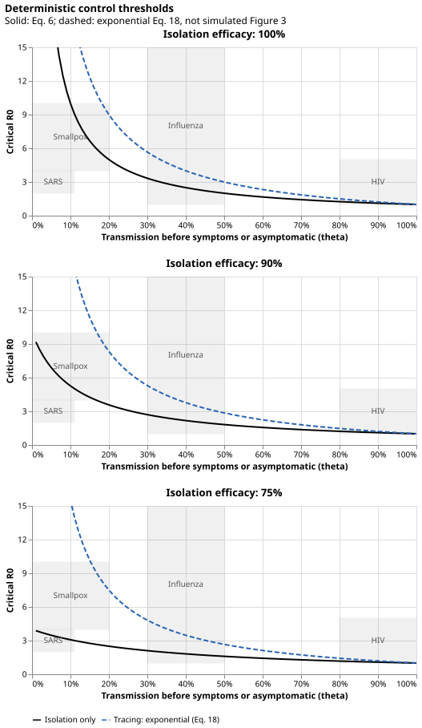

# Outbreak control thresholds

Re-implementation of the deterministic calculations in [Fraser et al. (2004)](https://doi.org/10.1073/pnas.0307506101).



The solid black lines reproduce Figure 3's isolation-only thresholds.
The dashed colored lines are **deterministic upper bounds on controllability** from the independent tracing approximation in Equation 16, not the paper's simulation-based colored curves.
This interpretation follows the paper's comparisons, not a general upper-bound theorem for arbitrary policies.
The approximation can substantially overstate tracing's benefit at imperfect isolation.
Simulation is documented but not yet implemented.

Panels use isolation efficacies of 100%, 90%, and 75%.
Tracing efficacy is 100% for the colored curves.
Blue uses variance / mean squared of 0.1; red uses 0.5.
Below a curve its model predicts eventual control; above it, growth.
Equality is the critical boundary, not strict control.
The y-axis stops at 15; higher thresholds and disease rectangles are clipped, not capped numerically.

The gray rectangles show the paper's historical disease ranges, not probability densities or confidence regions.
Their limitations are described in the methods.

## Methods

- [Deterministic mathematics](deterministic.md): the black lines, gamma calibration, an explicit matrix recipe for Equation 16, and the Equation 18 typo.
- [Simulation protocol](simulation.md): reported methods, omitted parameters, proposed choices, and validation requirements for the eventual simulation.
- [API reference](api.md): package functions.

## Reproduce

From the repository root:

```sh
uv run fraser
```

This writes `docs/figures/deterministic.svg` and `docs/figures/exponential.svg` using Altair and vl-convert.
No notebooks or HTML plot outputs are produced.
Use `uv run fraser --output-dir PATH` to change the destination.

```sh
uv run --group dev pytest
uv run --group dev ruff check src tests
uv run --group docs zensical build --strict
```
