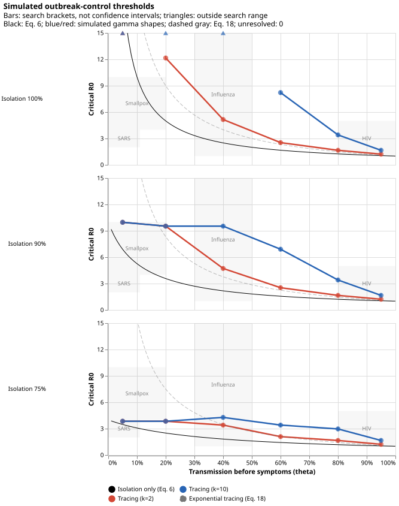

# Re-implementation of Fraser et al. (2004)

Re-implementation of [Fraser et al. (2004)](https://doi.org/10.1073/pnas.0307506101), focused on Figure 3's outbreak-control thresholds.
Run `uv run fraser` to search for critical R0 values and write the combined Altair SVG.

Panels show isolation efficacy 100%, 90%, and 75%.
Blue/red curves simulate tracing for gamma shapes 10/2; bars show bisection brackets, not confidence intervals.
Black is the exact isolation-only result (Equation 6); dashed gray is the exponential reference (corrected Equation 18).
Gray rectangles show historical disease ranges.

See the [simulation methods](simulation.md) and [deterministic derivation and typo note](deterministic.md).
