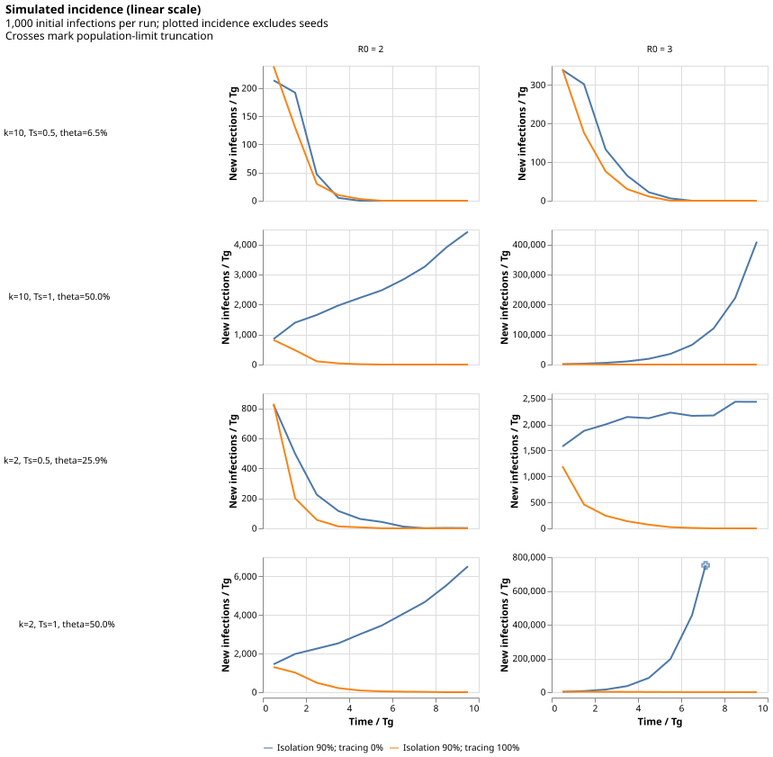
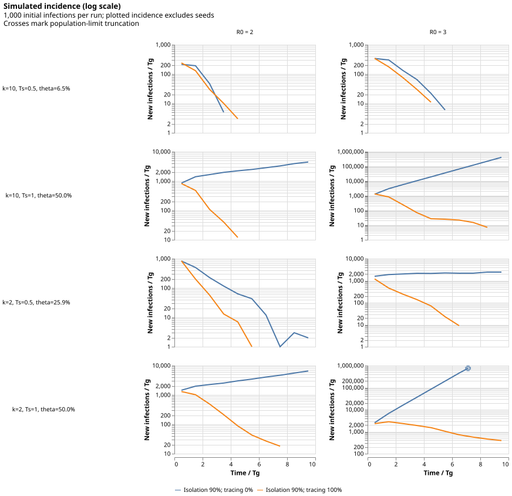

# Simulation protocol

The timestep simulator is implemented for exploratory incidence plots.
Growth-rate estimation and critical-R0 searches are deferred.

## Role of the simulation

Figure 3's black lines come from Equation 6.
Its colored lines show the results of 100 replicates of a stochastic, individual-based simulation.
The paper checks for $(R_0,\theta)$ combinations for which incidence neither grew nor declined on average.
Here, we simulate one population with many initial infections per scenario, rather than many single-seed replicates.
Different seed trees are independent, although tracing couples individuals within each tree.
Without per-tree resource limits or stopping, their combined incidence is equivalent in distribution to summing independent single-seed simulations.

## Model specified by the paper

- Homogeneous mixing
- No susceptible depletion
- Infectiousness: Common rate $\beta(\tau) = R_0g(\tau)$; $g$ is gamma.
- Incubation: Independent individual draws with survival function $S$ for gamma distribution.
- Shape: $1/0.1 = 10$ ("low variance") or $1/0.5 = 2$ ("high variance") for both distributions
- Isolation efficacy: 1, 0.9, or 0.75
- Tracing efficacy: 1
- Replicates: 100 per evaluated parameter combination
- Step size: Reduced until convergence; final value not given

## Gamma parameterization

We specify the mean $\mu$ and the shape $k$.
(The paper specifies these values in the form $\mathrm{variance} = 1/k \times \mathrm{mean}^2$.)
Infectiousness and incubation densities have the same shape.

We fix $T_g = 1$ to set the time scale.
We vary the mean $T_s$ of the symptom onset distribution and $R_0$ over a grid.

This makes $\theta$ a derived parameter.
For potential transmission age $G \sim \mathrm{Gamma}(\mu = 1, k)$ and symptom onset age $T \sim \mathrm{Gamma}(\mu = T_s, k)$, we have

$$
  \theta = \mathbb{P}[G<T] = I_{T_s/(1+T_s)}(k,k)
$$

where $I$ is the regularized incomplete beta function.

In code, the infectiousness scale is $1/k$ and incubation scale is $T_s/k$.
`presymptomatic_fraction(symptom_mean, shape)` evaluates this identity with SciPy's `betainc`.
This is the continuous-time, no-intervention theta; timestep discretization slightly changes the realized timing of transmission and removal.

```python
from fraser import simulate

result = simulate(
    r0=2,
    symptom_mean=1,
    shape=2,
    isolation=0.9,
    tracing=1,
    initial_infections=1_000,
    timestep=0.01,
    duration=10,
    seed=2004,
)
print(result.theta, result.completed, result.total_infections)
```

## Algorithm

The model state consists of:

- the clock time and
- infected people and their states.

Each person's state includes:

- infection (clock) time
- symptom onset delay (allowing derivation of the symptom onset clock time)
- infector
- infectees
- isolated y/n
- quarantined y/n
- symptoms processed y/n
- contacts traced y/n

Upon person instantiation (i.e., infection), draw the incubation period (i.e., symptom onset delay).
Round symptom times up to a timestep, with a minimum delay of one step.
Records use growing NumPy arrays and parent/child links.
Retain removed individuals because their subsequent symptoms can initiate tracing.

At simulation start, infect $Y_i$ individuals at age zero, without infectors.
Then iterate:

1. Advance time (and infection ages) by $\delta$.
1. Select a snapshot of people who are neither isolated nor quarantined.
   Draw their $\mathrm{Poisson}(\beta(\tau)\delta)$ infections in one vectorized call, using precomputed rates by integer infection age.
1. Create all newborn infections at the current clock time, assign parents, and draw symptom delays.
   Newborns are excluded from this step's transmission snapshot.
1. Process symptoms.
   For each newly-symptomatic person:
    - If they were previously quarantined, isolate them, and quarantine each of their (not-isolated and not-quarantined) infectees with probability $\varepsilon_T$.
    - Otherwise, isolate them with probability $\varepsilon_I$.
      If isolated, quarantine each of their (not-isolated and not-quarantined) infectees with probability $\varepsilon_T$.
1. Process quarantine cascades.
   For each newly-quarantined person whose symptoms had already onset, quarantine each of their (not-isolated and not-quarantined) infectees with probability $\varepsilon_T$.
   Recurse as needed.
   Such symptomatic contacts are also marked isolated.
   A queue and traced-once flags prevent repeated tracing.

Note that:

- Infected people are assumed to infect no other people in the first $\delta$ time of their infection.
- Transmission precedes symptom processing, following the paper's stated order.
  The resulting artificial removal delay should shrink with $\delta$.
- Symptoms are processed once; failed isolation is not retried on later steps.
- Previously-quarantined, now-symptomatic people are isolated with probability 1, not $\varepsilon_I$.
  This is our convention for treating quarantined symptomatic people as isolated cases, not an explicit Bernoulli rule from the paper.
- Quarantine blocks transmission but preserves later symptom-triggered tracing.
  The paper's simulation step 3 says only "not isolated"; this interpretation is supported by its definition of transmitting individuals as neither quarantined nor isolated (p. 6148) and effective isolation of traced contacts (p.
  6150).
- There is no backward tracking, uninfected contact screening, etc.
- Isolation is all-or-nothing.
- An otherwise successful quarantine attempt has no effect on a quarantined or isolated person.
  (This is not specified explicitly in the paper.)
- Quarantine cascades are not specified in the paper.
  Our cascades pass through already-symptomatic people, never through presymptomatic people.

## Exploratory defaults

These are implementation choices, not settings supplied by the paper:

They are collected in the `SIMULATION_SETTINGS` block near the top of the package entry point.
Edit that block to change the experiment; simulation parameters are not CLI options.

- Initial infections: 1,000 per scenario
- Timestep: 0.01
- Horizon: 10, an integer number of timesteps
- R0 values: 2 and 3
- Symptom-onset means: 0.5 and 1
- Shapes: 2 and 10
- Isolation efficacy: 0.9
- Tracing efficacy: compare 0 against 1
- Size bound: $10^6$ cumulative infections, including seeds
- Master random seed: 2004; independent `SeedSequence` streams for CLI grid locations
- Incidence bins: width 1, an integer number of timesteps

All times are in units of $T_g = 1$.
There is no stopping after a zero-incidence timestep: gamma infectiousness has an unbounded tail.
If the next birth batch would exceed the size bound, reject that entire step and return only previously completed steps with `completed=False`.
No partial birth batch is retained; the reported population can therefore be below the cap.
This is resource truncation, not extinction or an estimate of growth.

`SimulationResult` includes per-step new infections, isolations, and quarantines, plus input parameters, theta, seed, total infections, and completion status.
Incidence excludes the initial infections.
Isolation and quarantine counts are events, not disjoint population totals: someone may be quarantined and later isolated.
Full person records and per-seed uncertainty estimates are not returned.

## Run and inspect

```sh
uv run fraser simulate
```

This runs all 16 combinations above and writes two Altair SVGs:

- `docs/figures/simulation-linear.svg`
- `docs/figures/simulation-log.svg`





Each curve represents one large simulation.
The first point is **new infections during the first bin**, not the 1,000 initial infections.
For example, a first-bin count of 200 does not mean that simulation started with 200 people.
The seed count is displayed separately in the figure subtitle.

Incidence is averaged within time bins and plotted at their midpoints, in new infections per unit generation time.
Bins cover successive timestep groups $(a,b]$; a final short bin uses its actual duration.
Zero-incidence bins are missing on the log plot, not replaced with pseudocounts.
Crosses mark population-limited runs' last recorded bins, not the exact stopping time; console output reports the latter.
Policies share a y-axis within each panel, with independent y-scales across parameter combinations.

To change the experiment, edit the settings block, for example:

```python
SIMULATION_SETTINGS = {
    "r0": [2],
    "symptom_mean": [1],
    "shape": [2],
    "isolation": 0.9,
    "tracing": 1,
    "initial_infections": 10_000,
    "timestep": 0.005,
    "duration": 20,
    "max_infections": 5_000_000,
    "seed": 2004,
    "bin_width": 1,
}
```

Run the same `uv run fraser simulate` command after editing.
The only simulation-command option is `--output-dir`, for example `uv run fraser simulate --output-dir /tmp/fraser`.
The command compares tracing off against the requested tracing efficacy.
The Python `simulate(...)` API still accepts its parameters directly.

## Growth fitting: next stage

No growth fit or automated threshold search is implemented yet.
The initial fitting window will start at time 0, using all observed incidence bins at their midpoints, not the seed population as an incidence observation.
Fit log incidence against **time**, excluding zero bins explicitly rather than adding pseudocounts.
Compare the result after dropping the first bin to check leverage from initialization; full-window fitting is an exploratory choice, not a guarantee of asymptotic growth.
Resource-truncated histories require separate handling before using fits to infer a critical R0.

## Validation status

Tests cover reproducibility, mean-based theta, birth accounting, first-step Poisson transmission, no same-step newborn transmission, symptom and quarantine cascades, dynamic array growth, resource limits, and SVG export.
With zero isolation efficacy, a test verifies identical seeded incidence with tracing on and off.
These are algorithm checks, not a claim that Figure 3 has been reproduced.

Before interpreting a critical boundary, also check:

1. With tracing off, recover Equation 6 for both variances and all three isolation efficacies within Monte Carlo uncertainty.
1. With exponential distributions (shape 1) and perfect isolation, compare the realistic simulation's thresholds to corrected Equation 18, where the paper reports agreement.
1. Refine timestep, lengthen horizon, vary fitting windows, and increase seeds and replicates.
   Require changes small compared with reported uncertainty; check ambiguous same-step conventions separately.
